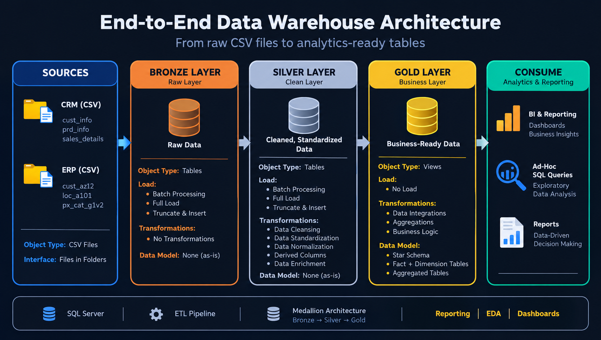

# SQL Data Warehouse Project

## Project Overview

This project demonstrates the development of an end-to-end SQL data warehouse using Microsoft SQL Server. It integrates data from Customer Relationship Management (CRM) and Enterprise Resource Planning (ERP) source systems into a structured data warehouse designed to support data analysis and reporting.

The project follows a **Medallion Architecture**, organising data into Bronze, Silver, and Gold layers. SQL scripts are used to create the database and schemas, load source data, transform and prepare data, and perform data quality checks.

The Gold layer provides business-ready data structures to support business intelligence, reporting, and ad hoc SQL analysis.

## Project Objectives

- Develop a structured data warehouse using SQL Server.
- Integrate data from CRM and ERP source systems.
- Implement a Bronze, Silver, and Gold layered architecture.
- Create SQL scripts and stored procedures for data loading and transformation.
- Clean, standardise, and prepare data for downstream analysis.
- Implement data quality checks for the Silver and Gold layers.
- Document the data architecture, data flow, data integration, data model, and naming conventions.
- Prepare business-ready data for analytical queries and reporting.

## Data Architecture

The project follows a Medallion Architecture that processes source data through three layers: Bronze, Silver, and Gold.



### Bronze Layer — Raw Data

The Bronze layer serves as the raw data landing area for the source files from CRM and ERP systems.

- Stores raw source data in tables.
- Uses batch processing and full-load operations.
- Applies a truncate-and-insert loading approach.
- Preserves source data without applying transformation logic in this layer.

**Key scripts:**
- `scripts/bronze/ddl_bronze.sql`
- `scripts/bronze/proc_load_bronze.sql`

### Silver Layer — Cleaned and Standardised Data

The Silver layer prepares source data for downstream use through cleansing, standardisation, and transformation.

- Stores processed data in tables.
- Applies data cleansing and standardisation.
- Supports data normalisation, derived columns, and data enrichment where implemented.
- Uses batch processing and full-load operations.
- Includes SQL scripts for data quality validation.

**Key scripts:**
- `scripts/silver/ddl_silver.sql`
- `scripts/silver/proc_load_silver.sql`
- `Tests/quality_checks_silver.sql`

### Gold Layer — Business-Ready Data

The Gold layer organises data into business-oriented structures for analytical queries and reporting.

- Defines Gold-layer database objects using SQL.
- Uses views to present business-ready data, as described in the architecture.
- Supports data integration, aggregations, and business logic.
- Provides a foundation for business intelligence, reporting, and ad hoc SQL queries.
- Includes data quality checks.

**Key scripts:**
- `scripts/gold/ddl_gold.sql`
- `Tests/quality_checks_gold.sql`

## Data Sources

The project uses six source datasets organised into CRM and ERP folders.

### CRM Source System

| Dataset | Description |
|---|---|
| `cust_info` | Customer information |
| `prd_info` | Product information |
| `sales_details` | Sales transaction information |

### ERP Source System

| Dataset | Description |
|---|---|
| `cust_az12` | Customer-related information |
| `loc_a101` | Location-related information |
| `px_cat_G1V2` | Product category and related information |

These datasets provide the source data for the warehouse loading and transformation workflow.

## Project Workflow

1. **Database initialisation:** Execute `scripts/Init_Database.sql` to create the data warehouse database and the Bronze, Silver, and Gold schemas.
2. **Source data preparation:** Organise the CRM and ERP datasets in the `datasets` directory.
3. **Bronze layer loading:** Create the Bronze tables and execute the Bronze loading procedure to load raw source data.
4. **Silver layer transformation:** Create the Silver tables and execute the Silver loading procedure to clean and transform data.
5. **Gold layer preparation:** Define the business-facing views and data structures used for analytics.
6. **Data quality validation:** Run the Silver and Gold quality-check scripts.
7. **Documentation:** Use the project diagrams and documentation to understand the architecture, data flow, integration, data model, and naming conventions.

## Repository Structure

```text
sql-data-warehouse-project/
├── datasets/
│   ├── source_crm/
│   │   ├── cust_info
│   │   ├── prd_info
│   │   └── sales_details
│   └── source_erp/
│       ├── cust_az12
│       ├── loc_a101
│       └── px_cat_G1V2
├── documents/
│   ├── data_architecture.png
│   ├── data_catalog.md
│   ├── data_flow.png
│   ├── data_integration.png
│   ├── data_model.png
│   └── naming_conventions.md
├── scripts/
│   ├── Init_Database.sql
│   ├── bronze/
│   │   ├── ddl_bronze.sql
│   │   └── proc_load_bronze.sql
│   ├── silver/
│   │   ├── ddl_silver.sql
│   │   └── proc_load_silver.sql
│   └── gold/
│       └── ddl_gold.sql
└── Tests/
    ├── quality_checks_silver.sql
    └── quality_checks_gold.sql
```

*Note: The tree shows the files identified from the project screenshots. Dataset extensions and any additional files should match the actual repository.*

## Documentation

The `documents` folder contains diagrams and supporting documentation for understanding the warehouse.

- **`data_architecture.png`** — illustrates the high-level architecture and the Bronze, Silver, and Gold layers.
- **`data_flow.png`** — illustrates the flow of data through the warehouse.
- **`data_integration.png`** — describes the integration of source data.
- **`data_model.png`** — provides a visual representation of the data model.
- **`data_catalog.md`** — documents data structures and related information.
- **`naming_conventions.md`** — describes the naming standards used in the project.

## Data Quality

Data quality checks are included for both the Silver and Gold layers.

| Script | Purpose |
|---|---|
| `Tests/quality_checks_silver.sql` | Checks data quality in the Silver layer. |
| `Tests/quality_checks_gold.sql` | Checks data quality in the Gold layer. |

These scripts support validation of data as it moves through the warehouse. Refer to the individual scripts for the specific checks and validation rules implemented.

## Tools & Technologies

- **Microsoft SQL Server**
- **SQL Server Management Studio (SSMS)**
- **Transact-SQL (T-SQL)**
- **Medallion Architecture**
- **ETL/ELT concepts**
- **Stored procedures**
- **Data transformation and cleansing**
- **Data modelling**
- **SQL-based data quality validation**

## Skills Demonstrated

- Database and schema creation
- SQL scripting and stored procedure development
- Source data integration
- Data loading and transformation
- Layered data warehouse design
- Data cleansing and standardisation
- Data modelling and documentation
- Data quality validation
- Preparing data for business intelligence and reporting

## Learning Outcomes

This project provided practical experience in building a layered SQL data warehouse, integrating CRM and ERP data, developing SQL loading and transformation procedures, and validating data quality across warehouse layers.

It demonstrates how SQL Server can be used to organise raw source data into structured, business-ready data for reporting and analytical use cases.

## Author

**Chintankumar Kanani**

Business Analytics | SQL | Data Engineering | Data Analysis | Business Intelligence
